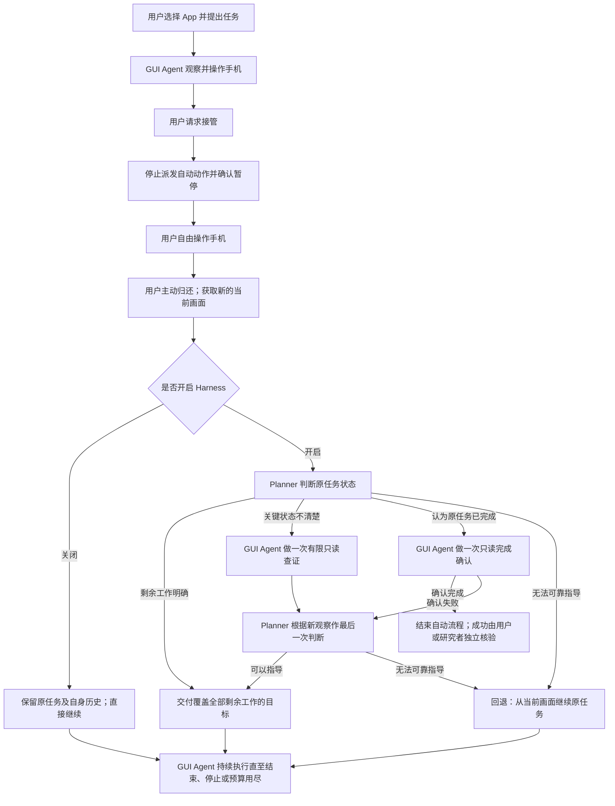

# HandoffHarness APK：项目背景与设计说明

更新：2026-10-30。

配套材料：[新对话提示词](HANDOFF_ANDROID_APK_PROMPT.txt) · [可复用的模型提示词](HANDOFF_ANDROID_APK_PROMPTS.md)

**这是一个将在用户本地电脑的新文件夹中开发的独立 Android 项目。** 下面说明要解决的问题、Harness 如何工作以及 APK 的目标，不预先决定技术栈或开发计划。三份材料可一起复制使用，无需访问原服务器或读取旧项目。

## 1. 背景：人把手机交给 Agent 后，仍可能临时接管

GUI Agent 根据手机画面选择操作，完成用户交给它的任务。执行期间，用户可能想亲自操作一会儿，再让 Agent 继续。

人工操作可能完成部分或全部工作、修改其他信息、撤销已有进展，或者只是浏览、切换页面。归还时，当前界面与实际进展可能已经不同于 Agent 记忆中的状态。直接延续旧计划，容易重复操作、遗漏剩余工作或覆盖用户修改。

例如：Agent 正在整理照片，用户接管后撤销了一部分移动，又停留在另一页面。归还后，Agent 应重新判断剩余工作，而不是盲目重放旧动作。

这一设计此前已用于服务器上的模拟器 Benchmark 实验。新项目延续研究方法，面向真实手机和后续 User Study，自行选择适合 APK 的实现。

## 2. APK 的使用目标

| 能力 | 要求 |
| --- | --- |
| 直接在手机使用 | 安装、授权后，可在手机上发起任务和交互，正常使用不依赖电脑通过 ADB 或 Appium 控制 |
| 自由选择 App 和任务 | 用户选择手机上的 App，用自然语言说明任务，不绑定固定任务集或预设初态 |
| 自由接管和归还 | 用户自行决定接管时机，在手机上自由操作，结束后主动把控制权交还 Agent |
| 配置模型服务 | GUI Agent 和 Planner 分别设置服务地址、模型名称与 API Key，可使用不同服务 |
| 开关 Harness | 任务开始前选择是否使用恢复辅助，支持后续有无 Harness 的对照研究 |
| 了解并控制运行状态 | 能分辨自动执行、正在暂停、人工控制、恢复准备、结束或出错，并可停止任务 |

模型在远程服务器或商业 API 上推理，手机负责交互、观察和操作执行，首期不做手机本地模型部署。电脑可以用于开发和安装调试，但不是日常运行时的控制器。

自由选择 App 不代表承诺所有 App 都能自动化。目标手机上的授权、受保护界面和可执行动作范围，需要后续验证，不能预设绕过系统限制。

## 3. Harness 如何工作

Harness 是决策模型外部的运行与协作机制。它不代替模型思考，而是管理**谁能操作手机、如何恢复任务、模型看到哪些历史，以及如何计步**。

| 角色 | 职责 |
| --- | --- |
| GUI Agent（操作决策模型） | 根据当前画面和当前目标，选择下一步手机操作 |
| Planner（恢复规划模型） | 在用户归还后，判断原任务状态，决定直接执行、先查证或回退 |
| 运行协调逻辑 | 管理控制权、观察采集、规划与执行的衔接、历史切换和预算；它不是另一个推理模型 |
| 手机执行端 | 获取可用画面，校验并执行动作，报告执行结果 |

### 一次接管与恢复的流程

用户再次请求接管时，也应先完成安全暂停。首期支持多少次接管，留待后续讨论；不能把某个任务脚本预设的入口当作用户接管的限制。

### 三种恢复选择

- **直接执行剩余工作：** Planner 给出覆盖原任务全部剩余工作的目标和可观察完成条件，由 GUI Agent 从当前画面继续。
- **先查证再决定：** 只查明会影响后续决策的关键状态，例如某项修改是否已保存。查证不得修改业务数据，查证结束也不代表原任务完成。
- **回退到原任务：** 无法可靠提供恢复指导时，让 GUI Agent 带着原任务及其原有自身历史，从当前画面继续。回退不是撤销用户操作，也不是恢复手机快照。

每次归还后的恢复准备，沿用最多两次 Planner 调用、最多一轮查证的设计。进入剩余工作执行或回退后，不再持续调用 Planner 重新规划。Planner 认为任务已经完成时，先安排只读确认；确认失败后只执行剩余工作或回退，不反复查证。

只读行为需要手机执行逻辑与模型适配共同约束，不能仅靠提示词承诺。模型表示结束，也不等于实际任务成功。

### 模型能看到什么，以及怎样管理历史

1. Planner 可使用原任务、Agent 自己成功执行的动作记录、可用的接管前观察、归还后的当前观察，以及查证新取得的观察。最新画面代表当前状态，旧画面只是历史证据。
2. 不向模型提供用户接管期间的动作轨迹或画面，不依赖隐藏数据库、脚本预设或评分证据。接管前最后一张画面也可能早于 Agent 自己最后一次动作的结果，不能把全部变化都归因于用户。
3. GUI Agent 开始查证或恢复执行时，分别建立新的阶段内对话，只积累该阶段自身历史。Planner 能参考旧历史，不代表 GUI Agent 仍要继承整段旧对话。
4. GUI Agent 收到原任务、Planner 交付的当前目标、可观察完成条件及当前画面。回退时恢复原任务对话，并以新画面继续。
5. 保留所选模型原有的消息组织、图片处理、坐标约定、动作格式和结束方式。Harness 的目标提示放入相应任务位置，不强迫各模型输出同一种动作格式。

用户操作不自动表示改变了委托目标。是否允许用户显式修改任务，作为另一项交互需求讨论。

### 执行与结束的边界

- 用户掌握控制权时，不派发自动操作；过期的模型回复在之后返回，也不能重新操作手机。归还后重新观察再决策。
- GUI 决策总额度默认 30 步，可由用户设置；接管前后、查证、恢复和回退共用。失败请求、无效决策及结束声明同样计入，人工操作不扣步数，也不补充额度。Planner 调用另计。
- 保留模型已有的结束方式，暂不要求它逐轮上报“哪些完成条件已经满足”，也不额外增加程序端的逐条件结束门槛。Planner 安排的只读查证或完成确认仍然保留。
- 完成条件是对目标的说明，由 GUI Agent 对照可见状态判断；不额外拼接上一动作反馈或内部诊断内容来绕过历史隔离。
- 请求失败要显式处理和记录，不通过隐藏重试、额外调用或更换子目标重置预算。

## 4. Harness 开关与 User Study

关闭恢复辅助时，用户仍可接管和归还，Agent 仍获得归还通知与新画面，使用原任务及自身历史直接继续；不开启恢复规划、新阶段历史或剩余目标注入。

开启恢复辅助时，使用上述判断、查证、目标交付及历史管理。对照研究固定 GUI 模型、服务参数、动作能力与预算，并保持同样的接管／归还通知和可用观察。自然用户交互不保证两次操作轨迹相同，不能直接当作严格配对实验解释。

会话应记录任务、实际模型与设置、控制权切换、模型决策及操作结果、恢复选择、步数、耗时和错误类别。区分模型表示结束、用户认为完成与研究者核验成功；自由任务没有现成的通用自动评分器。

截图和任务指令会发往用户配置的模型服务，应让用户知晓。密钥不写入普通日志、截图或导出记录；额外采集人工过程须单独明确，并与模型输入分开。模型调用错误、手机执行或授权问题、任务未完成分别记录。

## 5. 如何使用这份交接材料

三份文件已包含理解方法所需的背景和提示词。提示词附录区分英文原文、动态占位内容与已知限制，无需在原服务器查找。它提供方法层的提示，不预先选定某个模型的动作协议。

新的 Codex 对话应先与用户讨论手机与开发条件、技术方案、模型范围和研究需求，再确定开发计划。新项目可以独立实现以上设计；不把旧工程接口、配置名称或部署环境作为前置条件。本轮不创建 APK 工程，也不改变现有服务器项目和实验。
